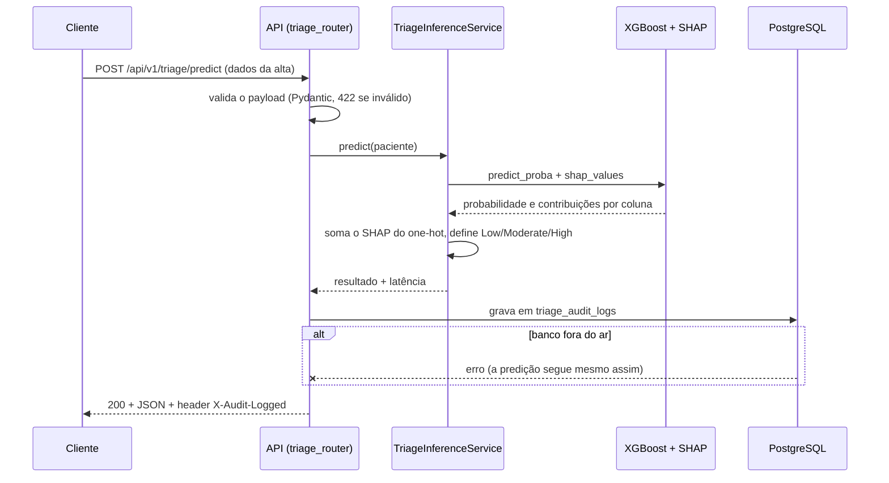

# 🏥 Hospital Triage AI — Predição de Readmissão em 30 Dias

API que estima o **risco de um paciente voltar a ser internado em até 30 dias** após a alta e explica **quais fatores mais pesaram** nessa estimativa, para apoiar a equipe a priorizar o acompanhamento pós-alta.


> ⚠️ Projeto de estudo com **dados sintéticos** inspirados na estrutura do MIMIC-IV. Não usar para decisões clínicas reais.

---

## 🎯 Objetivo

Readmissões em 30 dias são caras e, muitas vezes, evitáveis. O objetivo do projeto é:

- **Identificar cedo** os pacientes com maior risco de readmissão, ainda na alta;
- **Explicar o porquê** de cada predição (SHAP), para que o profissional de saúde confie e possa agir;
- **Entregar via API**, pronta para ser integrada a um sistema hospitalar, com auditoria de cada predição.

## 🙋 Minha contribuição

Projeto individual. Desenvolvi de ponta a ponta, em 4 etapas:

| Etapa | O que fiz |
|---|---|
| **Dia 1 — Dados e modelo** | Gerador de dados sintéticos com correlações clinicamente plausíveis (idade → comorbidades → tempo de internação → readmissão), prevalência calibrada em 15%. Treino com XGBoost, validação cruzada estratificada, escolha do limiar por Youden e cálculo de importância global com SHAP. |
| **Dia 2 — Infraestrutura** | Configuração por variáveis de ambiente (`pydantic-settings`), camada de banco assíncrona (PostgreSQL/SQLite) e contratos de entrada/saída com validação de faixas (Pydantic v2). IDs pseudonimizados pensando na LGPD. |
| **Dia 3 — API** | Serviço de inferência com explicação SHAP por paciente, rota `POST /api/v1/triage/predict`, `GET /health` para monitoramento e log de auditoria de cada predição. A API sobe em modo degradado se o modelo ou o banco falharem. |
| **Dia 4 — Testes e Docker** | 73 testes com pytest (pipeline, serviço e API, com o modelo treinado na própria suíte e SQLite no lugar do Postgres). Dockerfile multi-stage que treina o modelo durante o build e roda com usuário não-root, docker-compose com PostgreSQL e CI no GitHub Actions que sobe tudo e chama a API. |

**Decisões que tomei:**
- **XGBoost + SHAP** em vez de um modelo "caixa-preta" sem explicação: na saúde, a equipe precisa entender o motivo do alerta.
- **Limiar de Youden** em vez de 0,5 fixo: equilibra sensibilidade e especificidade numa base desbalanceada (15% de readmissões).
- **Arquitetura BCE** (Boundary-Control-Entity): separa API, regra de negócio e dados, o que facilita testes e manutenção.

## 📎 Evidências

### Métricas do modelo (conjunto de teste, 2.000 pacientes)
Fonte: [`models/metrics_report.json`](models/metrics_report.json)

| Métrica | Valor | O que significa |
|---|---|---|
| AUC-ROC | **0,79** | Boa capacidade de separar quem será e quem não será readmitido |
| Sensibilidade | **67,4%** | De cada 10 pacientes que voltam, o modelo sinaliza ~7 |
| Especificidade | 78,4% | Acerta a maioria dos que não voltam |
| VPN | **93,1%** | Quando o modelo diz "baixo risco", acerta 93% das vezes |
| Precisão (VPP) | 35,8% | Esperado com prevalência de 15%: o alerta serve para triagem, não para diagnóstico |

### Fatores que mais influenciam o risco (SHAP global)
Fonte: [`models/shap_global_importance.json`](models/shap_global_importance.json)

```
Idade                       ████████████████████████  0,575
Tipo de admissão            ████████████▌             0,300
Tempo de internação         ███████████▌              0,278
Nº de medicações            █████████▉                0,237
Insuficiência cardíaca      █████████▎                0,223
Doença renal crônica        ███████▋                  0,185
Diabetes                    ██████▍                   0,153
```

### Exemplo de resposta da API
```json
{
  "patient_id": "P-10482931",
  "risk_probability": 0.7124,
  "risk_category": "High",
  "readmission_predicted": true,
  "top_risk_factors": [
    { "feature": "comorbidity_heart_failure", "value": 1, "shap_value": 0.41, "direction": "increases_risk" }
  ],
  "model_version": "1.0.0"
}
```

## ⚙️ Como funciona uma predição



## 🗂 Estrutura

```
src/
├── pipelines/
│   ├── generate_mimic_data.py   # gera a base sintética
│   └── train_model.py           # treina, avalia e salva o modelo + SHAP
├── core/config.py               # configurações (variáveis TRIAGE_*)
├── database/                    # conexão assíncrona e tabela de auditoria
├── models/triage_schemas.py     # contratos da API (Pydantic)
├── services/inference_service.py# predição + explicação SHAP
├── api/v1/triage_router.py      # rotas /triage/predict e /health
└── main.py                      # aplicação FastAPI
tests/                           # pytest: pipeline, serviço e API
docker/Dockerfile                # build multi-stage (treina o modelo no build)
docker-compose.yml               # API + PostgreSQL
models/                          # métricas e importâncias SHAP
```

## ▶️ Como rodar

### Com Docker (API + PostgreSQL)

```bash
cp .env.example .env            # defina POSTGRES_PASSWORD
docker compose up --build -d
curl http://localhost:8000/health
```

O modelo é treinado dentro do build, então não precisa rodar nada antes. Em `production` o `/docs` fica desligado; para usar o Swagger, coloque `TRIAGE_ENVIRONMENT=development` no `.env`.

### Local

```bash
python -m venv .venv && .venv\Scripts\activate      # Linux/Mac: source .venv/bin/activate
pip install -r requirements.txt
copy .env.example .env                              # Linux/Mac: cp; use SQLite se não tiver PostgreSQL

python -m src.pipelines.generate_mimic_data --n-records 10000 --seed 42
python -m src.pipelines.train_model --data data/raw/mimic_synthetic.csv
uvicorn src.main:app --reload
```

Depois, abra **http://localhost:8000/docs** para testar a API pelo navegador.

### Testando com curl

```bash
curl -X POST http://localhost:8000/api/v1/triage/predict   -H "Content-Type: application/json"   -d '{
    "patient_id": "P-10482931",
    "age": 78,
    "gender": "F",
    "admission_type": "EMERGENCY",
    "length_of_stay": 9.5,
    "num_lab_procedures": 62,
    "num_medications": 21,
    "comorbidities": {"hypertension": true, "diabetes": true, "heart_failure": true, "coronary_artery_disease": true}
  }'
```

Comorbidades não informadas contam como `false`. Campos desconhecidos, idade abaixo de 18 ou `patient_id` com espaço/pontuação retornam 422.

### Testes

```bash
pip install -r requirements-dev.txt
python -m pytest
```

## 🔭 Próximos passos

- [x] Testes automatizados (pytest) e CI no GitHub Actions
- [x] Dockerfile e docker-compose com PostgreSQL
- [ ] Calibração de probabilidades e análise de justiça (fairness) por sexo e idade
- [ ] Painel simples para a equipe visualizar os pacientes de alto risco

## 👤 Autor

**Daniel Inocêncio** — [GitHub](https://github.com/danielinocencio536-png)
